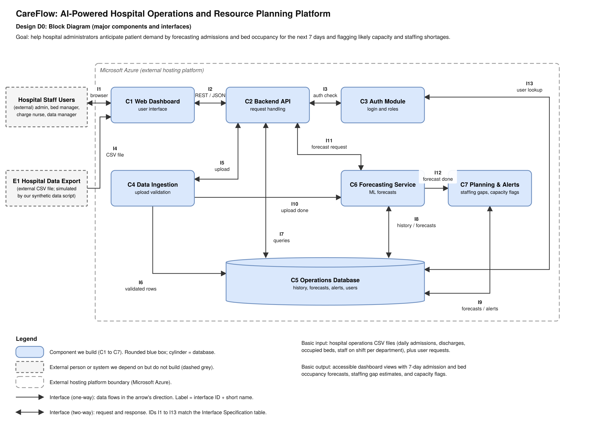
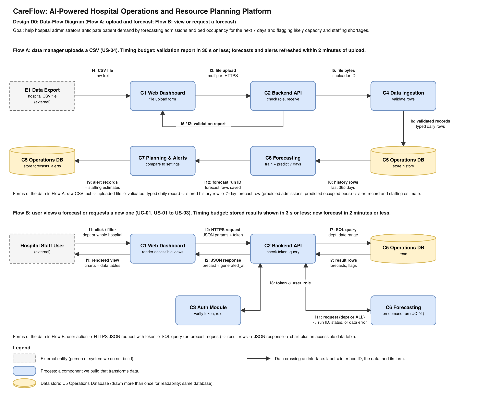

# D0 High-Level Design — CareFlow

**Team:** Vaishnavi Koduri, Nurik Najmiddinov\
**Advisor:** Dr. Yu Zhao\
**Course:** CS5001 Senior Design I, University of Cincinnati — Assignment 5 (Design D0)

## 1. Title, Goal Statement, and Conventions

**Project title:** CareFlow: AI-Powered Hospital Operations and Resource Planning Platform

**Goal statement:** Help hospital administrators anticipate patient demand by forecasting admissions and bed occupancy for the next 7 days and flagging likely capacity and staffing shortages.

**Basic input:** hospital operations CSV files uploaded by a data manager (daily admissions, discharges, occupied beds, bed capacity, and staff on shift per department), plus requests from hospital staff users.\
**Basic output:** accessible dashboard views showing current operations, 7-day admission and bed occupancy forecasts (hospital-wide or per department), staffing gap estimates, and capacity flags.

The design traces to the user stories US-01 to US-05 and use case UC-01 from our Assignment 4 requirements document (summarized in Appendix A).

**Conventions (also shown as a legend on each diagram):**

| Symbol | Meaning |
|---|---|
| Rounded blue box (C1–C7) | A component our team builds |
| Blue cylinder | A database component we build (C5) |
| Dashed grey box | An external person or system we depend on but do not build |
| Large dashed outline | External hosting platform (Microsoft Azure) |
| Arrow with one head | One-way interface; data moves in the arrow's direction |
| Arrow with two heads | Two-way interface (request and response) |
| Label I1–I13 | Interface ID; matches the Interface Specification table (Part 4) |
| Yellow cylinder (data-flow diagram only) | Data store (C5 Operations Database) |

## 2. Block Diagram (the D0 diagram) {.pb}



The system has **7 components we build** (C1–C7) and **3 external dependencies**: hospital staff users (administrators, bed managers, charge nurses, data managers), the hospital data export (CSV files, simulated by our synthetic data script during development), and the Microsoft Azure hosting platform. Source file: `D0_Block_Diagram.drawio`.

## 3. Component Responsibility Table {.pb}

| ID | Component | Responsibility (one sentence) | Interfaces in | Interfaces out | Primary owner | User stories |
|---|---|---|---|---|---|---|
| C1 | Web Dashboard | Presents forecasts, occupancy, staffing estimates, and upload results to users in an accessible browser interface. | I1, I4, I2 (responses) | I1 (views), I2 (requests) | Vaishnavi Koduri | US-01–05 |
| C2 | Backend API | Receives every request from the dashboard, checks access, and returns results as JSON. | I2, I3, I5, I7, I11 (results) | I2 (responses), I3, I5, I7, I11 | Vaishnavi Koduri | US-01–04 |
| C3 | Auth Module | Verifies each user's identity and role before any data is returned. | I3, I13 (user rows) | I3 (user, role), I13 | Nurik Najmiddinov | US-01–04 (UC-01 preconditions) |
| C4 | Data Ingestion | Validates uploaded operations files and reports every rejected row. | I5 | I5 (validation report), I6, I10 | Nurik Najmiddinov | US-04 |
| C5 | Operations Database | Stores history, forecasts, staffing estimates, flags, settings, and user accounts. | I6, I7, I8, I9, I13 | I7, I8, I9, I13 (rows) | Nurik Najmiddinov | US-01–04 |
| C6 | Forecasting Service | Produces 7-day admission and bed occupancy forecasts, per department and hospital-wide. | I8 (history), I10, I11 | I8 (forecast rows), I11 (status), I12 | Nurik Najmiddinov | US-01, US-02 |
| C7 | Planning & Alerts | Compares forecasts with capacity settings and staffing ratios to flag capacity and staffing gaps. | I9 (forecasts, settings), I12 | I9 (flags, staffing estimates) | Vaishnavi Koduri | US-02, US-03 |

Every user story maps to at least one component, and every component maps to at least one user story. US-05 (screen-reader access) is met in C1: every chart has a labeled data-table equivalent, headings and form fields are labeled, and nothing is shown by color alone.

*Deployment (Docker, Azure, CI/CD) is infrastructure rather than a runtime component; Nurik owns it per the team contract.*

## 4. Interface Specification Table

| ID | From ↔ To | Inputs (name: type) | Outputs (name: type) | Data format | Protocol | On error (handled by) |
|---|---|---|---|---|---|---|
| I1 | Users ↔ C1 | login form (email: string, password: string); scope: string (department ID or "ALL"); date range: date; file selection | rendered pages: charts with equivalent data tables, KPI cards, flags, upload results | Accessible HTML / CSS / JS | HTTPS (browser) | Failed load or invalid input: C1 shows a labeled, screen-reader-announced error message with a Retry option (C1). |
| I2 | C1 ↔ C2 | Authorization: Bearer token (string); scope: string; horizon_days: int (1–7); CSV upload (multipart file) | JSON objects: operations summary, forecast list with generated_at: datetime, staffing estimates, flags, validation report; error_code: string, message: string | JSON (UTF-8); multipart/form-data for uploads | REST over HTTPS (GET, POST, PATCH) | 400 bad parameters: C1 shows field error. 401 expired token: C1 returns to login. 403 wrong role: C1 shows "not permitted". 500/503: C1 shows retry message (C2 returns error JSON; C1 displays). |
| I3 | C2 ↔ C3 | email: string, password: string (login); token: string (each request) | access_token: string (JWT, 60-minute expiry); user_id: int; role: enum{admin, bed_manager, charge_nurse, data_manager} | Python objects (dict) | In-process function call | Wrong credentials, expired or invalid token: C3 raises AuthError; C2 returns 401 or 403 (C2). |
| I4 | E1 → C1 | operations CSV file selected from the user's computer | none (one-way) | CSV, UTF-8, header row, max 10 MB | Browser file selection | Wrong file type or size: C1 rejects it before upload and explains why (C1). |
| I5 | C2 ↔ C4 | file_bytes: bytes; uploader_id: int | validation report: rows_accepted: int, rows_rejected: int, errors: list of {row: int, field: string, reason: string}; import_batch_id: uuid | Python objects (dict) | In-process function call | Missing columns: whole file rejected with the missing column names. Bad values (negative counts, occupied beds > capacity, bad dates): those rows rejected and listed; valid rows continue (C4). |
| I6 | C4 → C5 | validated records: date: date, department: string, admissions: int, discharges: int, occupied_beds: int, bed_capacity: int, staff_on_shift: int, import_batch_id: uuid | rows_inserted: int | SQL rows | SQL over TCP (PostgreSQL protocol), one transaction per batch | Constraint or connection error: transaction rolled back, batch marked "failed", user told to retry (C4). |
| I7 | C2 ↔ C5 | read queries (scope: string, date range: date); settings updates | result rows: occupancy, forecasts, staffing estimates, flags | SQL rows | SQL over TCP | Query over 2 s or connection error: C2 returns 503 to C1 (C2). |
| I8 | C6 ↔ C5 | history rows: last 365 days of date, department, admissions, discharges, occupied_beds | forecast rows: run_id: uuid, scope: string, target_date: date, predicted_admissions: float, predicted_occupied_beds: float, generated_at: datetime, model_name: string | SQL rows | SQL over TCP | Fewer than 60 days of valid history: no forecast for that scope; error names the missing data (UC-01 exception flow). Write failure: run marked "failed"; previous forecast stays visible (C6). |
| I9 | C7 ↔ C5 | forecast rows for run_id; settings (department, capacity_threshold_pct: float, patients_per_staff: float); staff_on_shift: int | flag rows: flag_id: int, department, type: enum{capacity, staffing}, severity: enum{warning, critical}, target_date: date, message: string; staffing estimate rows: required_staff: int, available_staff: int, gap: int | SQL rows | SQL over TCP | Missing settings: default 90% threshold used and the flag is marked "default setting". Write failure: logged and retried on the next run (C7). |
| I10 | C4 → C6 | import_batch_id: uuid; departments: list[string] | run_id: uuid; status: enum{success, partial, failed} | Python objects (dict) | In-process function call, started after the import commits | Forecast failure does not undo the import; status "failed" is logged and the previous forecast stays visible (C4 logs, C6 reports). |
| I11 | C2 ↔ C6 | scope: string (department ID or "ALL"); horizon_days: int (7) | run_id: uuid; status: enum{success, failed}; data_errors: list of string | Python objects (dict) | In-process function call | Missing or invalid data: no forecast is generated and data_errors lists what must be corrected; C2 returns 422 and C1 displays it (UC-01 exception flow; C6 detects, C1 shows). |
| I12 | C6 → C7 | run_id: uuid | flags_created: int | Python objects (dict) | In-process function call | C7 failure leaves forecasts valid; error logged and flags re-evaluated on the next run (C7). |
| I13 | C3 ↔ C5 | email: string | user row: user_id: int, password_hash: string, role: enum | SQL rows | SQL over TCP | User not found: C3 returns the same "invalid email or password" message as a wrong password (C3). |

**Example payload (I2, response to `GET /api/v1/forecasts?scope=ICU&horizon_days=3`):**

```json
{
  "scope": "ICU",
  "run_id": "6f1c2a9e-4b7d-4e2a-9c51-0d3e8a7b1f20",
  "generated_at": "2026-11-15T14:05:00Z",
  "bed_capacity": 30,
  "forecast": [
    {"date": "2026-11-16", "predicted_admissions": 12.0, "predicted_occupied_beds": 27.1, "occupancy_pct": 90.3},
    {"date": "2026-11-17", "predicted_admissions": 13.5, "predicted_occupied_beds": 28.4, "occupancy_pct": 94.7},
    {"date": "2026-11-18", "predicted_admissions": 11.2, "predicted_occupied_beds": 27.6, "occupancy_pct": 92.0}
  ],
  "flags": [
    {"flag_id": 418, "type": "capacity", "severity": "warning", "target_date": "2026-11-17",
     "message": "ICU projected at 94.7% occupancy (threshold 90%)"}
  ]
}
```

## 5. Data-Flow Diagram {.pb}



CareFlow has **two distinct flows**, and both are drawn (source file: `D0_Data_Flow.drawio`):

- **Flow A — upload and forecast (US-04).** A data manager selects a CSV file (I4), uploads it through the dashboard (I2), and C2 passes it to C4 (I5). Valid rows become typed daily records stored in C5 (I6); a validation report goes back to the user. C4 then starts a forecast run (I10): C6 reads stored history (I8), writes 7-day forecast rows, and hands the run to C7 (I12), which writes capacity flags and staffing estimates (I9). **Timing budget:** validation report in 30 seconds or less; forecasts and flags refreshed within 2 minutes of upload.
- **Flow B — view or request a forecast (UC-01, US-01 to US-03).** A user selects a department or the whole hospital (I1); C1 sends a request with a token (I2); C3 checks the user and role (I3); C2 reads stored forecasts, occupancy, and flags (I7) and returns JSON including `generated_at` (I2), which C1 shows as a chart plus an equivalent data table (I1). When an administrator asks for a new forecast, C2 calls C6 directly (I11); if data is missing or invalid, no forecast is made and the error names the problem (UC-01 exception flow). **Timing budget:** stored results shown in 3 seconds or less; a new forecast in 2 minutes or less.

## 6. Architecture Pattern and Justification

**Chosen pattern: a layered client-server system for user requests, combined with a pipeline for data processing and forecasting, deployed as one backend application (modular monolith).**

| Part of the system | Governing pattern |
|---|---|
| C1 (client) ↔ C2, C3, C4, C6, C7 (application layer) ↔ C5 (data layer) | **Layered client-server**: the browser only talks to C2; C2 is the only entry into the application layer; only server components touch the database. |
| Upload → C4 → C5 → C6 → C7 → C5 | **Pipeline**: each stage takes the previous stage's output, transforms it, and passes it on (raw file → validated rows → stored history → forecast → flags). |

**Justification against the five criteria:**

1. **Fit to the problem.** CareFlow has two kinds of work: people asking for views or forecasts (request and response, best served by client-server) and uploaded data moving through fixed transformation steps (best served by a pipeline). Each pattern governs the part it fits.
2. **Team skills.** We are a two-person team. Both of us know Python and React; one backend codebase with clear layers is something we can both build, test, and explain, without running several separately deployed services.
3. **Performance and timing.** Flow B's 3-second budget is met because normal views read stored forecasts instead of running the model on every page load. The 2-minute budget for a new forecast is realistic for a few departments and one year of daily data; nothing needs real-time processing (scope assumption 7: no real-time hospital integration).
4. **Scalability.** Expected load is a handful of staff users and a few departments, so one small server is enough. Because the pipeline stages already have clean interfaces (I5, I6, I8, I10, I12), any stage can later move to its own service if load grows.
5. **Hardware and budget constraints.** There is no special hardware; CareFlow is a web application. Our Week 3 constraints (no funding beyond the Azure for Students credit; aggregated data only, no patient-identifiable records) favor one small Azure app plus one small database and training models on our own laptops rather than paying for cloud GPUs.

**Rejected patterns:**

- **Microservices (rejected).** Splitting C1–C7 into separately deployed services would add networking, service discovery, and per-service hosting costs that a two-person team and a $100 credit cannot support, with no performance benefit at our scale.
- **Embedded sensor-actuator (rejected).** CareFlow reads uploaded daily summary files, not live sensor streams, and controls no devices (scope assumption 9: it does not assign beds or change schedules), so this pattern does not fit.
- **Pure pipeline for everything (rejected).** Users need on-demand answers (choosing a department, requesting a new forecast), which a one-way pipeline cannot provide.

## 7. Decision Log

| # | Decision | Alternatives considered | Why the chosen option won |
|---|---|---|---|
| DL-1 | Use a **synthetic dataset** generated by our own script as the data source during development. | Restricted research datasets of real hospital records; public hospital-level datasets. | Real patient-level data requires training, a data use agreement, and secure storage (Week 3 constraints), and public datasets lack daily department-level counts. Synthetic CSV files go through the same upload interface (I4/I5), so real aggregated data can replace them later if our advisor agrees. |
| DL-2 | **One backend application with clear modules** (modular monolith). | Microservices (one service per component); serverless functions. | Lowest cost and complexity for a two-person team; one deployment to test and host on the Azure credit. Module boundaries (I3, I5, I10, I11, I12) keep the option to split later. |
| DL-3 | **Store forecasts and serve stored results**; generate new ones automatically after each upload and when an administrator requests one (UC-01). | Run the model on every page view; generate forecasts only on a fixed nightly schedule. | Running the model on every view would break the 3-second budget and waste compute. A fixed nightly schedule would not support UC-01, where an administrator requests a forecast and sees its generation time. |
| DL-4 | **Rule-based capacity and staffing flags** (configurable thresholds and staffing ratios) in C7. | ML anomaly detection for alerts. | Thresholds are easy to understand and adjust (scope assumption 5: configurable planning assumptions), and planners can trust a rule they can read. ML is already used where it adds value (forecasting). |
| DL-5 | **Relational database** for all stored data. | Document (NoSQL) database; plain CSV files on disk. | Our data is naturally tabular (department × date) and relationships matter (forecast → flag → department). A relational database enforces constraints that catch bad data and supports simple dashboard queries; CSV files cannot be shared safely by several components. |

## Appendix A. User Stories and Use Case Used for Traceability

From our Assignment 4 requirements document:

| ID | Stakeholder | User story (summary) | Components |
|---|---|---|---|
| US-01 | Hospital Administrator (primary) | View predicted admissions and bed occupancy for the upcoming seven days to plan resources. | C1, C2, C3, C5, C6 |
| US-02 | Bed Manager (primary) | View current and predicted bed occupancy across departments to identify departments approaching capacity. | C1, C2, C3, C5, C6, C7 |
| US-03 | Charge Nurse (primary) | Compare estimated staffing requirements with available staffing in my department to identify shortages. | C1, C2, C3, C5, C7 |
| US-04 | Hospital Data Manager (secondary) | Upload and validate hospital operational data so forecasts use accurate information. | C1, C2, C3, C4, C5 |
| US-05 | Staff member using a screen reader (hidden) | Access reports and forecasts with properly labeled content and accessible navigation. | C1 |
| UC-01 | Hospital Administrator | Generate a 7-day demand forecast (hospital-wide or one department); stop with a clear error if data is missing or invalid. | C1, C2, C3, C5, C6 (via I11) |
