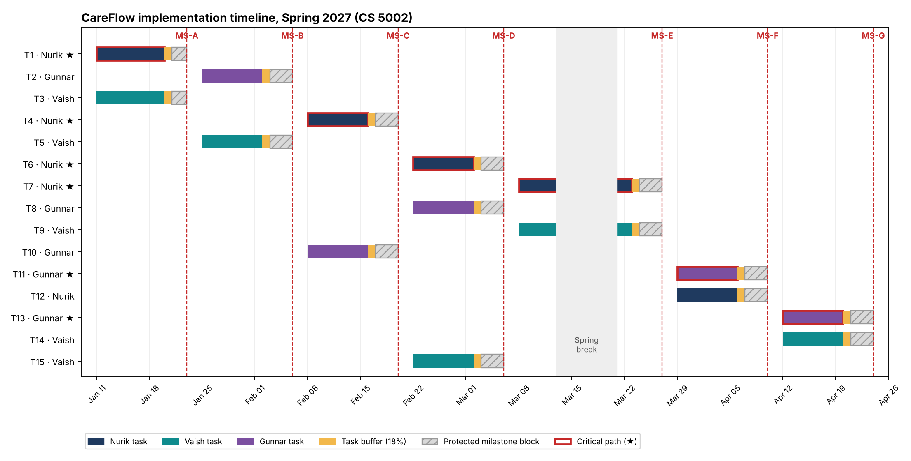

# CareFlow: Task List, Milestones, Timeline, and Effort Matrix

**CS 5001 Senior Design I, Assignment 8** · University of Cincinnati  
**Team:** Nurik Najmiddinov, Vaishnavi Koduri, Gunnar Heiert  
**Advisor:** Dr. Yu Zhao · **Instructor:** Dr. Justin Zhan  
**Project:** CareFlow, an AI-powered hospital operations and resource planning platform

**Team.** Gunnar Heiert joined the team on November 17 at our advisor's request. Work is divided across all three members, five tasks each.

**Planning assumptions.** Nurik and Vaish are on campus in Spring 2027 with no co-op rotation; Gunnar's spring availability is to be confirmed. Each member plans about 8 to 12 hours per week on the project. UC Spring 2027 runs January 11 to April 29, with Martin Luther King Jr. Day on January 18 and spring break March 15 to 21; final exams are the last week of April. No project tasks are scheduled during fall final exams, winter break (mid-December to January 10), or spring break. Each task's hours use the three-point estimate (O + 4M + P) / 6 plus an 18% buffer.

## 1. Task List (Assignment #5)

Fifteen tasks, five per member, each one to two weeks long. Module names match Project-Description.md and Design D0 to D2. The same list is in `Tasklist.md` at the repository root.

**T1.** Develop the C5 Operations Database schema, migrations, and seed accounts from the D1 ERD (7 entities, UUID run_id). *Module: C5 Operations Database.* **Owner: Nurik.**

**T2.** Develop the C3 Auth Module: password hashing, 60-minute JWT issue and verification (I3), user lookup over I13, and role checks for the four roles. *Module: C3 Auth Module.* **Owner: Gunnar.**

**T3.** Develop the C2 Backend API skeleton, the OpenAPI contract for I2, and the database access layer for I7. *Module: C2 Backend API.* **Owner: Vaish.**

**T4.** Develop the C4 Data Ingestion upload path: header and row validation, transactional import into C5 (I5, I6), and the rejected-row validation report. *Module: C4 Data Ingestion.* **Owner: Nurik.**

**T5.** Develop the C1 Web Dashboard shell: sign-in page, navigation, department filter, and current-operations views over I1 and I2. *Module: C1 Web Dashboard.* **Owner: Vaish.**

**T6.** Obtain and validate the Python-generated synthetic dataset for the three departments and build the feature set used by the C6 Forecasting Service. *Module: C6 Forecasting Service.* **Owner: Nurik.**

**T7.** Develop the C6 Forecasting Service: 7-day admission and bed occupancy models, the baseline, and the ForecastRun states QUEUED, RUNNING, SUCCESS, FAILED (I8, I10, I11). *Module: C6 Forecasting Service.* **Owner: Nurik.**

**T8.** Develop the C7 Planning & Alerts rules that compare forecasts with capacity settings and staffing ratios and write flags to C5 (I9, I12). *Module: C7 Planning & Alerts.* **Owner: Gunnar.**

**T9.** Develop the C1 Web Dashboard forecast, alert, and upload pages with Plotly charts, the 90% threshold line, and data-table alternatives. *Module: C1 Web Dashboard.* **Owner: Vaish.**

**T10.** Develop the deployment pipeline: Docker images for C1, C2, and C6, GitHub Actions CI, and an Azure staging environment. *Module: Microsoft Azure (deployment).* **Owner: Gunnar.**

**T11.** Test the integrated system: integration tests for I1 to I13, role-access tests, and timing tests for the 3 s, 2 min, and 30 s budgets. *Module: C1 to C7 (system).* **Owner: Gunnar.**

**T12.** Validate and refine the C6 Forecasting Service models against the baseline using MAE, RMSE, WAPE, and forecast bias. *Module: C6 Forecasting Service.* **Owner: Nurik.**

**T13.** Document the user guide, deployment guide, and final design report, and update README.md and Design_Diagrams to match the built system. *Module: All modules (documentation).* **Owner: Gunnar.**

**T14.** Refine C1 and C2 by fixing defects found in T11 and applying accessibility and usability fixes before release v1.0. *Module: C1 Web Dashboard, C2 Backend API.* **Owner: Vaish.**

**T15.** Develop the C1 Web Dashboard settings and administration pages: capacity thresholds, staffing ratios, and user role management for the admin role. *Module: C1 Web Dashboard.* **Owner: Vaish.**

## 2. Milestones List (Assignment #6)

### 2.1 Course deliverables, CS 5001

Our team registered for the course partway through the semester, so assignments from A6 onward are being completed on a catch-up schedule. The Canvas due date and our planned completion date are both shown.

| # | Deliverable | What it demonstrates | Canvas due | Completed / planned | Verified by | Status |
|---|---|---|---|---|---|---|
| A1 | Professional biography | Each member's background and project interests | Sep 2, 2026 | Complete | Instructor | **Complete** |
| A2 | Team formation and project description | CareFlow problem, solution, and scope defined | Sep 9, 2026 | Complete | Instructor | **Complete** |
| A3 | Advisor selection and design constraints essay | Dr. Yu Zhao confirmed as advisor; design constraints analyzed | Sep 18, 2026 | Complete | Instructor; advisor approval | **Complete** |
| A4 | User stories and use cases | US-01 to US-05 and UC-01, UC-02 with acceptance criteria | Sep 28, 2026 | Complete | Instructor | **Complete** |
| A5 | High-level system design (D0) | Components C1 to C7 and interfaces I1 to I13 | Oct 2, 2026 | Complete | Instructor; advisor | **Complete** |
| A6 | Detailed system design, part 1 (D1) | ERD with 7 entities and 8 relationships | Oct 8, 2026 | Complete | Instructor; advisor | **Complete** |
| A7 | Detailed system design, part 2 (D2) and peer review notes | Dashboard mockup, ingestion error flow, auth and role flow, ForecastRun state machine | Oct 14, 2026 | Nov 25, 2026 | Instructor; peer team | **Complete** |
| A8 | Task list, milestones, timeline, and effort matrix | Design turned into a plan with owners and dates (this document) | Oct 28, 2026 | Nov 25, 2026 | Instructor; advisor | **Complete** |
| A9 | Requirements document and technical specification document | Requirements traceable to C1 to C7 and testable | Oct 30, 2026 | Nov 27, 2026 | Instructor; advisor | Planned |
| A10 | Test and validation plan draft | Test cases for I1 to I13, timing budgets, and model metrics | Nov 4, 2026 | Nov 29, 2026 | Instructor | Planned |
| A11 | Ethics and responsible-use statement | Synthetic-data, privacy, and human-in-the-loop safeguards | Nov 11, 2026 | Nov 30, 2026 | Instructor | Planned |
| A12 | Presentation draft and documented advisor feedback | Advisor has reviewed the presentation and feedback is recorded | Nov 18, 2026 | Dec 1, 2026 | Dr. Yu Zhao | Planned |
| A13 | Team oral presentation, recorded video, and peer reviews | Team presents the CareFlow design and plan | Nov 18, 2026 | Dec 3, 2026 | Instructor; peer teams | Planned |
| A14 | Design report, design notebook, and team and self assessment | Complete CS 5001 design record; reproduces Tables 1 and 2 | Dec 2, 2026 | Dec 2, 2026 | Instructor; advisor | Planned |
| A15 | Project advisor assessments | Advisor's assessment of team progress | Nov 25, 2026 | Dec 2, 2026 | Dr. Yu Zhao | Planned |
| A16 | ABET teamwork survey | Each member's assessment of team participation | Dec 4, 2026 | Dec 4, 2026 | Instructor | Planned |

### 2.2 Internal milestones, CS 5002 implementation (Spring 2027)

Each milestone is a checkable outcome at the end of a two-week window (three weeks across spring break).

| # | Milestone | What it demonstrates | Date | How it is verified | Verified by |
|---|---|---|---|---|---|
| MS-A | Data layer and API skeleton | C5 Operations Database schema from the D1 ERD is migrated on PostgreSQL, and C2 Backend API runs with a health endpoint and an OpenAPI contract covering I2 and I7. | Fri, Jan 22, 2027 | Migration script runs on a clean database; OpenAPI file reviewed against D2 interface tables. | Vaish reviews T1; Nurik reviews T3 |
| MS-B | Secure login end to end | A user signs in on C1 Web Dashboard, C3 Auth Module issues a 60-minute JWT, and a protected C2 endpoint returns 200 for an allowed role and 403 for a disallowed one. | Fri, Feb 5, 2027 | Live demo with one account per role; automated auth tests pass in CI. | Dr. Yu Zhao (advisor meeting) |
| MS-C | Upload path and staging deployment | A sample operations CSV goes C1 to C2 to C4 Data Ingestion to C5, and the validation report returns within 30 s. Every merge to main deploys automatically to an Azure staging environment. | Fri, Feb 19, 2027 | Timed upload of a 90-day sample file with three bad rows; GitHub Actions run history. | Nurik (upload); Gunnar (pipeline) |
| MS-D | Synthetic dataset and alerts engine | Two years of synthetic daily data for Emergency, Medical-Surgical, and ICU are loaded through C4, and C7 Planning & Alerts raises capacity and staffing flags from a test forecast. | Fri, Mar 5, 2027 | Data profile report; C7 unit tests with threshold cases at 89%, 90%, and 91%. | Dr. Yu Zhao (mid-semester review) |
| MS-E | Feature-complete CareFlow | C6 Forecasting Service produces a 7-day forecast within 2 minutes, and C1 shows forecasts, alerts, and upload history with a data-table alternative for every chart. | Fri, Mar 26, 2027 | End-to-end demo following UC-01 and UC-02 on the staging site. | Both members; demo to Dr. Yu Zhao |
| MS-F | Verified system | All I1 to I13 integration tests pass, the 3 s, 2 min, and 30 s timing budgets are met, and the selected model beats the baseline on MAE and WAPE. | Fri, Apr 9, 2027 | Test report and model evaluation report committed to the repository. | Gunnar (tests); Nurik (model evaluation) |
| MS-G | Final release v1.0 | Release v1.0 is tagged and deployed, and the user guide, deployment guide, and final report are complete for the CS 5002 final presentation. | Fri, Apr 23, 2027 | Tagged release on GitHub; documents reviewed by both members and the advisor. | Dr. Yu Zhao and Dr. Justin Zhan |

## 3. Table 1: Timeline (Assignment #6)

Planned work runs from Start to Planned finish. The task buffer (18%, rounded to whole days) follows, and Completion is the committed date. A protected block of two to three working days before every milestone absorbs slippage on the critical path and is not assigned new work. ★ marks the critical path.

| ID | Task | Owner | Start | Planned finish | Task buffer | Completion | Protected block | Depends on |
|---|---|---|---|---|---|---|---|---|
| T1 ★ | Develop the C5 Operations Database schema, migrations, and seed accounts from the D1 ERD (7 entities, UUID run_id). | Nurik | Jan 11 | Jan 19 | Jan 20 (1 d) | Jan 20 | Jan 21 to Jan 22 | - |
| T3 | Develop the C2 Backend API skeleton, the OpenAPI contract for I2, and the database access layer for I7. | Vaish | Jan 11 | Jan 19 | Jan 20 (1 d) | Jan 20 | Jan 21 to Jan 22 | - |
| **MS-A** | **Milestone: Data layer and API skeleton** | Both | | | | **Jan 22** | | T1, T3 |
| T2 | Develop the C3 Auth Module: password hashing, 60-minute JWT issue and verification (I3), user lookup over I13, and role checks for the four roles. | Gunnar | Jan 25 | Feb 1 | Feb 2 (1 d) | Feb 2 | Feb 3 to Feb 5 | T1, T3 |
| T5 | Develop the C1 Web Dashboard shell: sign-in page, navigation, department filter, and current-operations views over I1 and I2. | Vaish | Jan 25 | Feb 1 | Feb 2 (1 d) | Feb 2 | Feb 3 to Feb 5 | T3 |
| **MS-B** | **Milestone: Secure login end to end** | Both | | | | **Feb 5** | | T2, T5 |
| T4 ★ | Develop the C4 Data Ingestion upload path: header and row validation, transactional import into C5 (I5, I6), and the rejected-row validation report. | Nurik | Feb 8 | Feb 15 | Feb 16 (1 d) | Feb 16 | Feb 17 to Feb 19 | T1, T3 |
| T10 | Develop the deployment pipeline: Docker images for C1, C2, and C6, GitHub Actions CI, and an Azure staging environment. | Gunnar | Feb 8 | Feb 15 | Feb 16 (1 d) | Feb 16 | Feb 17 to Feb 19 | T3 |
| **MS-C** | **Milestone: Upload path and staging deployment** | Both | | | | **Feb 19** | | T4, T10 |
| T6 ★ | Obtain and validate the Python-generated synthetic dataset for the three departments and build the feature set used by the C6 Forecasting Service. | Nurik | Feb 22 | Mar 1 | Mar 2 (1 d) | Mar 2 | Mar 3 to Mar 5 | T4 |
| T8 | Develop the C7 Planning & Alerts rules that compare forecasts with capacity settings and staffing ratios and write flags to C5 (I9, I12). | Gunnar | Feb 22 | Mar 1 | Mar 2 (1 d) | Mar 2 | Mar 3 to Mar 5 | T1, T3 |
| T15 | Develop the C1 Web Dashboard settings and administration pages: capacity thresholds, staffing ratios, and user role management for the admin role. | Vaish | Feb 22 | Mar 1 | Mar 2 (1 d) | Mar 2 | Mar 3 to Mar 5 | T3, T5 |
| **MS-D** | **Milestone: Synthetic dataset and alerts engine** | Both | | | | **Mar 5** | | T6, T8, T15 |
| T7 ★ | Develop the C6 Forecasting Service: 7-day admission and bed occupancy models, the baseline, and the ForecastRun states QUEUED, RUNNING, SUCCESS, FAILED (I8, I10, I11). | Nurik | Mar 8 | Mar 22 | Mar 23 (1 d) | Mar 23 | Mar 24 to Mar 26 | T6 |
| T9 | Develop the C1 Web Dashboard forecast, alert, and upload pages with Plotly charts, the 90% threshold line, and data-table alternatives. | Vaish | Mar 8 | Mar 22 | Mar 23 (1 d) | Mar 23 | Mar 24 to Mar 26 | T4, T5, T8 |
| **MS-E** | **Milestone: Feature-complete CareFlow** | Both | | | | **Mar 26** | | T7, T9 |
| T11 ★ | Test the integrated system: integration tests for I1 to I13, role-access tests, and timing tests for the 3 s, 2 min, and 30 s budgets. | Gunnar | Mar 29 | Apr 5 | Apr 6 (1 d) | Apr 6 | Apr 7 to Apr 9 | T7, T9, T10 |
| T12 | Validate and refine the C6 Forecasting Service models against the baseline using MAE, RMSE, WAPE, and forecast bias. | Nurik | Mar 29 | Apr 5 | Apr 6 (1 d) | Apr 6 | Apr 7 to Apr 9 | T7 |
| **MS-F** | **Milestone: Verified system** | Both | | | | **Apr 9** | | T11, T12 |
| T13 ★ | Document the user guide, deployment guide, and final design report, and update README.md and Design_Diagrams to match the built system. | Gunnar | Apr 12 | Apr 19 | Apr 20 (1 d) | Apr 20 | Apr 21 to Apr 23 | T11, T12 |
| T14 | Refine C1 and C2 by fixing defects found in T11 and applying accessibility and usability fixes before release v1.0. | Vaish | Apr 12 | Apr 19 | Apr 20 (1 d) | Apr 20 | Apr 21 to Apr 23 | T11 |
| **MS-G** | **Milestone: Final release v1.0** | Both | | | | **Apr 23** | | T13, T14 |

**Critical path:** T1 → T4 → T6 → T7 → T11 → T13 → MS-G. T7 (C6 Forecasting Service) is the longest and riskiest task, and its window spans spring break, so it gets the three-week MS-E window. If T7 slips past its protected block, T12 starts with the baseline model only (risk R1), and T11 tests against the baseline so testing is not blocked.



## 4. Table 2: Effort Matrix (Assignment #6)

Hours per task. The owner's hours are the three-point estimate plus 18% buffer; the designated reviewer's hours are code review, pairing, and integration support. **Bold** marks the one member of primary responsibility, who carries the largest share of every task.

| ID | Module | O | M | P | (O+4M+P)/6 | Nurik | Vaish | Gunnar | Row total |
|---|---|---|---|---|---|---|---|---|---|
| T1 | C5 Operations Database | 8 | 12 | 20 | 12.7 | **15** | 3 | - | 18 |
| T2 | C3 Auth Module | 10 | 14 | 22 | 14.7 | 3 | - | **17** | 20 |
| T3 | C2 Backend API | 10 | 16 | 26 | 16.7 | 3 | **20** | - | 23 |
| T4 | C4 Data Ingestion | 12 | 18 | 30 | 19.0 | **22** | - | 3 | 25 |
| T5 | C1 Web Dashboard | 12 | 18 | 28 | 18.7 | - | **22** | 2 | 24 |
| T6 | C6 Forecasting Service | 8 | 12 | 20 | 12.7 | **15** | - | 2 | 17 |
| T7 | C6 Forecasting Service | 16 | 24 | 40 | 25.3 | **30** | 3 | - | 33 |
| T8 | C7 Planning & Alerts | 10 | 16 | 24 | 16.3 | 3 | - | **19** | 22 |
| T9 | C1 Web Dashboard | 14 | 20 | 32 | 21.0 | 3 | **25** | - | 28 |
| T10 | Microsoft Azure (deployment) | 10 | 16 | 28 | 17.0 | - | 3 | **20** | 23 |
| T11 | C1 to C7 (system) | 12 | 18 | 26 | 18.3 | 5 | - | **22** | 27 |
| T12 | C6 Forecasting Service | 8 | 12 | 20 | 12.7 | **15** | - | 2 | 17 |
| T13 | All modules (documentation) | 10 | 14 | 20 | 14.3 | 5 | - | **17** | 22 |
| T14 | C1 Web Dashboard, C2 Backend API | 8 | 12 | 20 | 12.7 | - | **15** | 3 | 18 |
| T15 | C1 Web Dashboard | 10 | 14 | 22 | 14.7 | - | **17** | 2 | 19 |
| **Total** | | | | | | **119** | **108** | **109** | **336** |
| **Share** | | | | | | **35%** | **32%** | **32%** | 100% |

**Balance.** The largest and smallest columns (Nurik and Vaish) differ by 11 hours, 10% of an even share. Each task has one designated reviewer who carries its support hours. We compare logged hours against this table at every milestone. If one column runs more than 10% above an even share, the next unstarted reviewer role moves to the member with the fewest hours, and Tables 1 and 2 are updated in the repository. Gunnar joined after the design phase, so he reviews T4, T5, and T6 early on to learn the codebase before his own tasks.

Spread over the 15-week semester, this is about 8 hours per week for Nurik, 7 hours per week for Vaish, 7 hours per week for Gunnar, leaving room for team meetings, advisor meetings, and CS 5002 course deliverables.

## 5. Work Breakdown Structure

```
CareFlow (CS 5002 implementation)
├── 1 Foundation  [MS-A, MS-B]
│   ├── T1  C5 Operations Database  (Nurik)
│   ├── T3  C2 Backend API  (Vaish)
│   ├── T2  C3 Auth Module  (Gunnar)
│   └── T5  C1 Web Dashboard  (Vaish)
├── 2 Data path and infrastructure  [MS-C]
│   ├── T4  C4 Data Ingestion  (Nurik)
│   └── T10  Microsoft Azure (deployment)  (Gunnar)
├── 3 Data, planning logic, and settings  [MS-D]
│   ├── T6  C6 Forecasting Service  (Nurik)
│   ├── T8  C7 Planning & Alerts  (Gunnar)
│   └── T15  C1 Web Dashboard  (Vaish)
├── 4 Forecasting and full dashboard  [MS-E]
│   ├── T7  C6 Forecasting Service  (Nurik)
│   └── T9  C1 Web Dashboard  (Vaish)
├── 5 Verification  [MS-F]
│   ├── T12  C6 Forecasting Service  (Nurik)
│   └── T11  C1 to C7 (system)  (Gunnar)
└── 6 Release  [MS-G]
    ├── T13  All modules (documentation)  (Gunnar)
    └── T14  C1 Web Dashboard, C2 Backend API  (Vaish)
```

Level 1 is the phase and level 2 is the Task List item. Every task appears once, with the same ID and owner as in Tables 1 and 2. CS 5001 course deliverables A1 to A16 are tracked as milestones in Section 2.1.

## 6. Risk Register

| # | Risk | Category | Likelihood | Impact | Strategy | Mitigation (where it shows in Table 1) | Owner | Trigger |
|---|---|---|---|---|---|---|---|---|
| R1 | Forecast models do not beat the baseline on synthetic data | Technical | Medium | High | Reduce | Baseline model is built first in T7, so a working forecast always exists; T12 is a dedicated refinement task; MS-E protected block | Nurik | Model MAE or WAPE not better than baseline at MS-E |
| R2 | Uneven participation, or a member becomes unavailable (Gunnar joined after the design phase) | Team | Medium | High | Reduce | Weekly team check-in; every task has a named reviewer who can take it over; 18% buffers and protected blocks; scope priority: C1 to C6 first, C7 staffing ratios can be simplified to capacity alerts only | Nurik | A task more than 2 working days past its Completion date, or a member misses two check-ins in a row |
| R3 | C6 work interrupted by spring break and midterms | Team | Medium | Medium | Avoid | No tasks scheduled March 15 to 21; T7 given a three-week window with a protected block before MS-E | Nurik | T7 less than half done on March 12 |
| R4 | Azure deployment problems or student credit limits | External | Medium | Medium | Reduce | Deploy to staging early (T10 by MS-C) so issues surface six weeks before release; Docker Compose local deployment as fallback | Gunnar | Staging deploy failing for more than 3 days, or credits below 25% |
| R5 | Interface mismatch between C1, C2, C4, and C6 | Technical | Medium | Medium | Reduce | OpenAPI contract fixed in T3 at MS-A; contract tests run in CI from MS-C | Vaish | CI contract tests failing after a merge |
| R6 | No access to real hospital data | External | High | Low | Accept | Project is designed on Python-generated synthetic data (T6); any real dataset is optional and decided with the advisor after MS-F | Nurik | Advisor requests real-data validation |
| R7 | Advisor feedback delayed | External | Low | Medium | Reduce | Advisor meetings booked for every milestone date in the first week of January | Vaish | No advisor response within 5 working days of a milestone |

High-impact schedule risks R1, R2, and R3 are visible in Table 1 through the critical-path markers, the T7 three-week window, and the protected blocks before every milestone.

## 7. Consistency check

All 15 tasks appear in the Task List, the work breakdown structure, Table 1, and Table 2 with the same ID, module, and owner. Every task links to one milestone, and every milestone has a date and a verifier.
